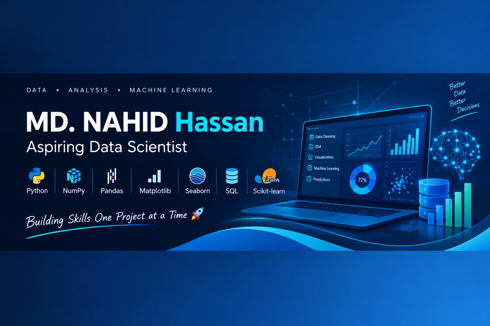

# 👋 Hi, I'm MD. NAHID Hassan

<p align="center">
  
</p>

<p align="center">
  <a href="https://github.com/Nahidhassn">
    
  </a>
</p>
```
<p align="center">
  <b>Aspiring Data Scientist | Python • Data Analysis • Machine Learning</b>
</p>

- 🐍 Working with Python, NumPy, and Pandas for data analysis.
- 📊 Practicing data cleaning, EDA, and data visualization.
- 🗄️ Learning SQL for database analysis.
- 🤖 Building machine learning projects with Scikit-learn.

---

## 🚀 About Me

I'm an aspiring data scientist from Bangladesh, passionate about exploring data, discovering patterns, and turning raw data into meaningful insights.

I enjoy working with real-world datasets and building practical machine learning projects while continuously improving my analytical and programming skills.

---

## 🛠️ Skills & Tools

**Programming & Data Analysis**

<p>
  
  
  
</p>

**Data Visualization**

<p>
  
  
</p>

**Database & Machine Learning**

<p>
  
  
</p>

**Tools**

<p>
  
  
  
</p>

---

## 📂 Featured Projects

| Project | Description |
|---|---|
| [🏨 Hotel Booking Cancellation Prediction](https://github.com/Nahidhassn/hotel-booking-cancellation-prediction) | Predicting hotel booking cancellations using booking data. |
| [🏦 Bank Marketing Term Deposit Prediction](https://github.com/Nahidhassn/bank-marketing-term-deposit-prediction) | Predicting customer term deposit subscriptions using marketing data. |
| [🩺 Breast Cancer Diagnosis Prediction](https://github.com/Nahidhassn/breast-cancer-diagnosis-prediction) | Applying machine learning to breast cancer diagnosis classification. |
| [📉 Customer Churn Prediction](https://github.com/Nahidhassn/customer-churn-prediction) | Predicting customers who may leave a service. |

<p align="center">
  <a href="https://github.com/Nahidhassn?tab=repositories">
    
  </a>
</p>

---

## 📊 GitHub Overview

<p align="center">
  
  
</p>

---

## 🤝 Connect with me!

<p>
  <a href="https://www.linkedin.com/in/md-nahid-hassan-3a9257419/?lipi=urn%3Ali%3Apage%3Ad_flagship3_notifications%3BjXuwn1UeRCuuGdTxSmolhg%3D%3D">
    
  </a>
</p>

---

## 💼 For Business Inquiries

<p>
  <a href="mailto:nahidhassan.ctc@gmail.com">
    
  </a>
</p>

📩 **Email:** [nahidhassan.ctc@gmail.com](mailto:nahidhassan.ctc@gmail.com)

---

<p align="center">
  <i>Learning every day • Building projects • Growing through data 🚀</i>
</p>
